# 掌上hbu

河北大学校园 App：课表、圈子、成绩、考试、校历、办事大厅。
个人开发，**非学校官方发布**。

- 仓库：<https://github.com/CybaerKON/zhangshanghbu>（公开仓库，欢迎提 Issue / PR）
- 包名 `com.hbu.zhangshanghbu` · 版本 1.0.0beta3（versionCode 7）· minSdk 26 / targetSdk 34
- 版本规则：`1.0.0betaN`，每出一次测试包 N +1（versionCode 单调递增，保证能覆盖安装）
- 许可：**AGPL-3.0**（可以改、可以商用，但改完必须同样开源 —— 即**不允许闭源商业版**），
  第三方来源见 [THIRD-PARTY.md](THIRD-PARTY.md)
- 零第三方依赖（纯 Android framework，不含 androidx / Compose）
- `bash build.sh` 一条命令出 APK（aapt2 + javac + d8 + apksigner），不需要 Gradle

| | | |
| --- | --- | --- |
| 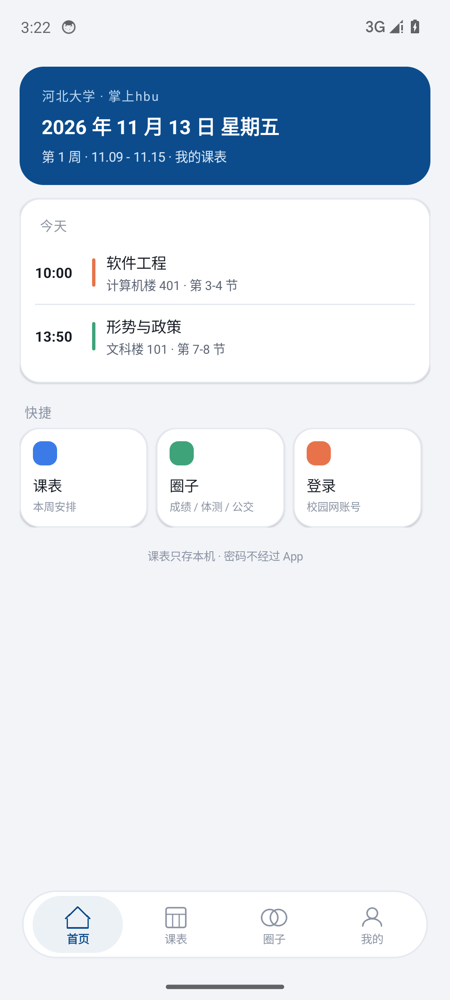 | 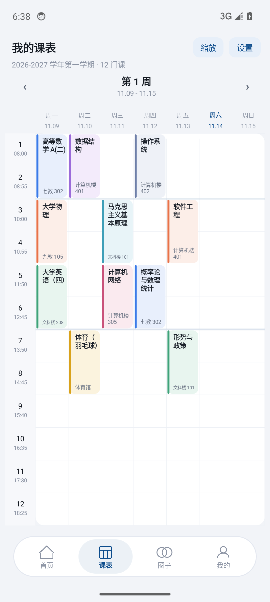 | 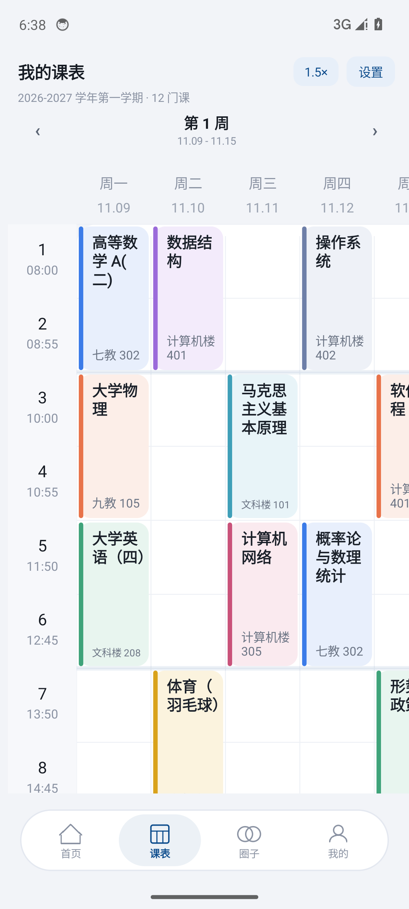 |
| 首页：今天上什么课 | 课表：周视图、翻周 | 整页放大 1.5×（也可双指缩放） |
| 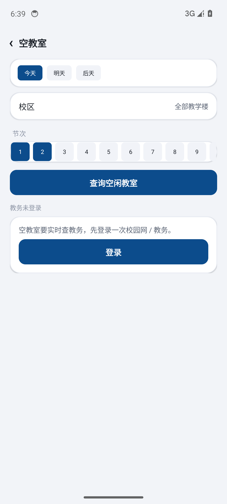 | 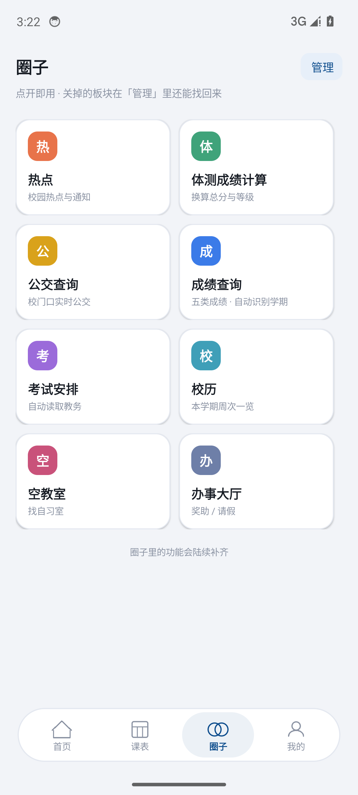 | 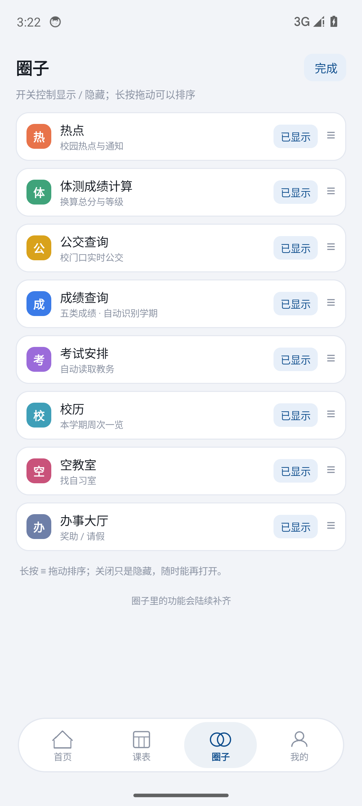 |
| 空教室：按节次实时查 | 圈子：入口聚合 | 管理：开关 / 拖动排序 |
| 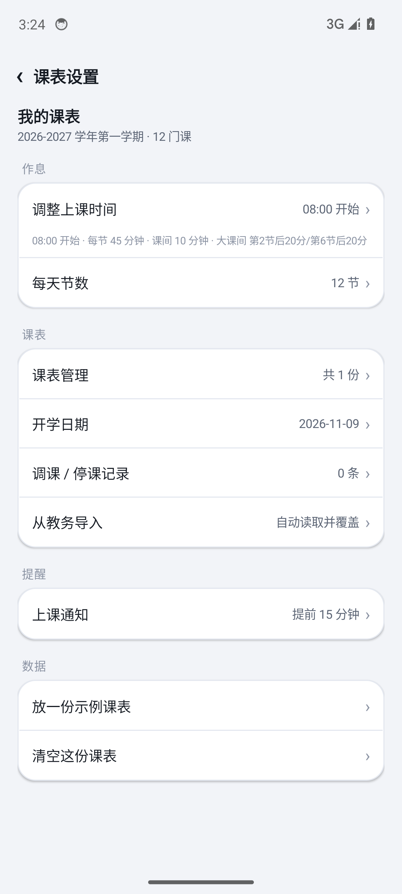 | 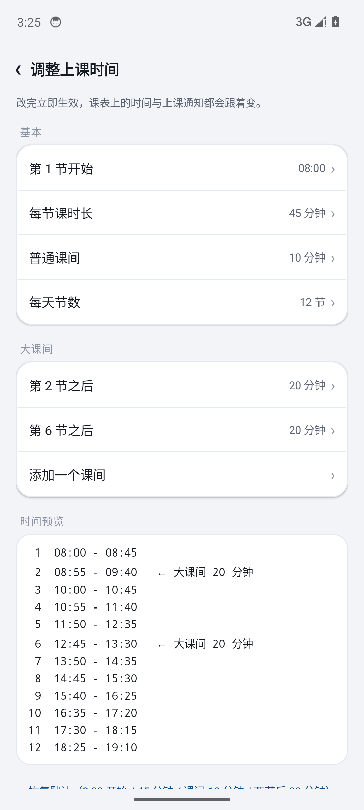 | 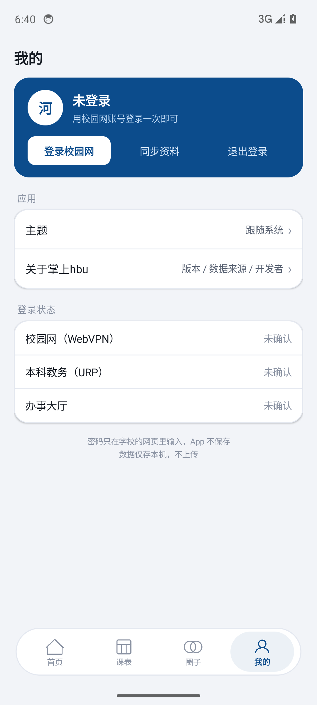 |
| 课表设置：作息 / 多课表 / 调课 | 上课时间与大课间 | 我的：资料 / 主题 / 关于 |
| 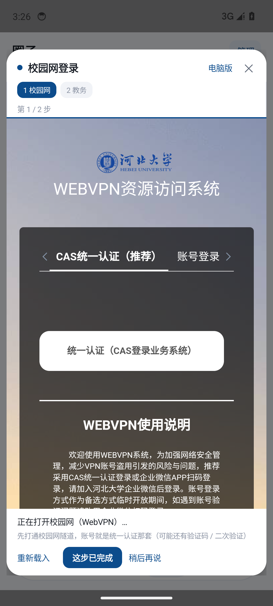 | 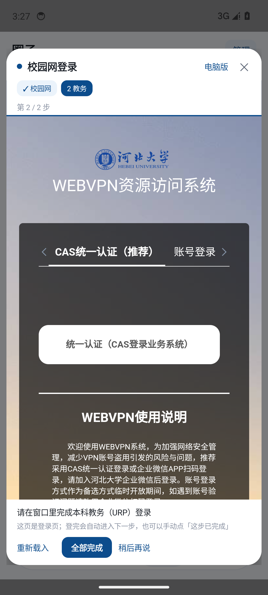 | 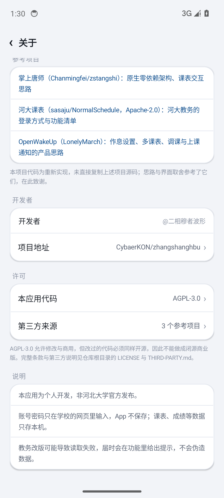 |
| 校园网登录窗口（CAS 统一认证） | 顺序登录：校园网 → 教务 | 关于：版本 / 来源 / 许可 |
| 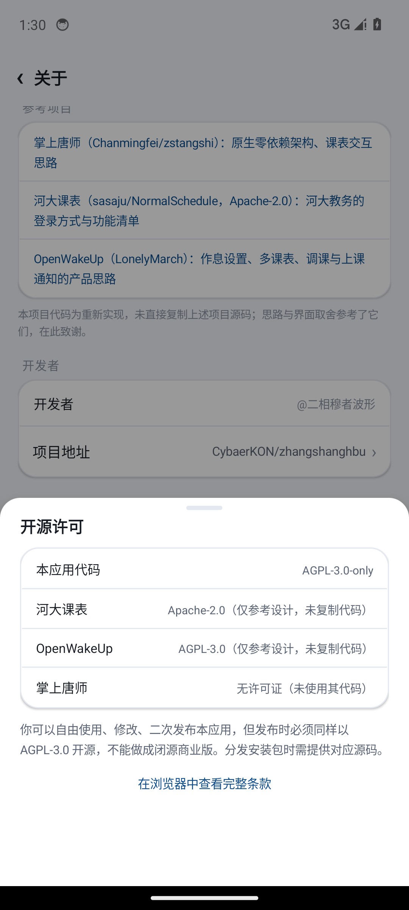 | | |
| 开源许可：本应用 AGPL-3.0，三个参考项目逐个标注 | | |

> 截图在 Android 14 模拟器上运行得出，课表用的是示例数据（登录需要河大账号）。

---

## 一、参考项目

这个项目从零重写，但产品思路与若干实现取舍明确参考了下面三个开源项目，在此致谢：

| 项目 | 借鉴的部分 |
| --- | --- |
| [掌上唐师 zstangshi](https://github.com/Chanmingfei/zstangshi) | 原生零依赖架构、自绘课表与手势的思路、按学期分键的本地存储 |
| [河大课表 NormalSchedule](https://github.com/sasaju/NormalSchedule)（Apache-2.0） | 河大教务的入口方式（统一认证 / URP）与功能清单、多课表与调课的交互 |
| [OpenWakeUp](https://github.com/LonelyMarch/OpenWakeUp)（AGPL-3.0） | 作息模板（节长 / 课间 / 大课间）、多课表、调课记录、上课通知的产品设计 |

本项目**没有直接复制上述项目的源码**；解析器、取数引擎、UI 都是重新实现的。
各项目的版权归原作者，详见 [NOTICE.md](NOTICE.md)。

## 二、校园网登录（一处登录，处处可用）

河大校外访问教务的真实链路（2026-11 实测）：

```
zhjw.hbu.edu.cn ──302──▶ v.hbu.cn/http/<enc>/   （网瑞达 WebVPN，需登录）
                              │  账号 + 图形验证码 + 短信 / TOTP
                              ▼
                          URP 综合教务（清元优软，JSP + frameset，GB2312）
cas.hbu.edu.cn  统一身份认证（前端 SPA，带二级验证）
ehall.hbu.edu.cn 办事大厅      xsfwpt.hbu.cn 学生事务平台
```

**为什么登录必须在 WebView 里做**：校外教务挂在 WebVPN 的 `/http/<enc>/` 编码路径下，
前缀随会话生成；登录页还有验证码与二次验证。原生表单拼不出来，也不该拼 ——
账号密码只在学校页面里输入，App 不保存密码，只留 Cookie 快照。

登录窗口（`campus/LoginDialog.java`）只有**一次统一认证**，不再让用户逐个平台登：

1. 打开校园网 `v.hbu.cn/login`，自动点「统一认证（CAS登录业务系统）」；
2. CAS 登录（含短信 / 扫码二次验证）完成后，等 WebVPN 的会话票回来 ——
   **不按 URL 猜**，否则会打断 `?cas_login=true&ticket=…` 这一跳，票送不到就会被打回登录页；
3. 票到手后**静默**打开教务验证：能单点进去就直接跳过；只有教务确实要自己登一次时，
   才把它的登录页显示出来；
4. 办事大厅不参与默认流程，点「办事大厅」里的功能时才按需登录。

- 全程只有一条状态栏，没有「第 1/2/3 步」的步骤条；
- 认证跳转中的页面（`ticket` / `cas_login` / `loginAgain` / CAS 页）一律不决策，等它跳完；
- 重启后静默检查一次：掉了会在首页/圈子挂提示（写明是哪个平台），
  用到相关功能时自动弹登录窗口；**课表是本地数据，不受影响**。

设计细节见 [docs/LOGIN.md](docs/LOGIN.md)。

## 三、课表

- **周视图**：自绘网格，左右翻周，点课程看详情；同一格多门课会平分显示；
- **多份课表**：课表 → 设置 → 课表管理，可新建 / 重命名 / 删除 / 切换，互不覆盖；
- **作息可调**：第 1 节开始时间、每节时长、普通课间、大课间（位置 + 时长，可加多个）；
  课程块按节次画，**跨越大课间的课不会被切断**，只是结束时间把大课间算进去；
- **临时调课 / 停课**：点某节课 → 「本周停课」或「临时调课」（换周 / 换天 / 换节），
  只影响那一次，原位置显示「调走」；
- **上课通知**：可设提前 X 分钟；开启时自动检查通知权限（Android 13+ 会申请
  `POST_NOTIFICATIONS`），没开权限会明确提示并可一键跳转系统设置；
- **手动加课 / 改课**：教务没抓到的课、临时加的课都存在本地，重新导入时不会被覆盖；
- **整页缩放**：双指可以缩放，右上角「缩放」按钮也能在 1× → 1.5× → 2× 之间切。
  缩放是**整页等比**的（格子宽高、字号、间距一起放大），放大后横向和纵向都能滚动，
  不是只把行拉高。窄格子里的教室名会先缩字号；实在放不下就断成「计算机楼 / 401」
  这种两行，不会把 401 劈成「40 / 1」。

## 四、圈子

圈子取代了原来的「成绩」页，是一堆入口的聚合页：

| 入口 | 状态 |
| --- | --- |
| 热点 | 开发中（点开明确提示） |
| 体测成绩计算 | 开发中 |
| 公交查询 | 开发中 |
| 成绩查询 | 可用：五类口径，见下 |
| 考试安排 | 可用：读教务的考试表格（按课程 / 按日期） |
| 校历 | 开发中（先占位，后面接学校正式校历） |
| 空教室 | 可用：按节次实时查询，原生页面 |
| 办事大厅 | 可用：内置浏览器（已登录态） |

右上角「管理」是统一控制入口：开关控制显示/隐藏（关闭＝隐藏，数据不删），
长按右侧 ≡ 可以拖动排序。顺序与显隐都记在本机。

## 五、成绩（五种口径）

| 口径 | 数据来源 |
| --- | --- |
| 全部及格 | `gradeLnAllAction.do?type=ln&oper=qbinfo` |
| 课程属性 | 优先用页面上发现的真实页签地址，兜底 `oper=kcsx` |
| 方案成绩 | 优先页签地址，兜底 `oper=pyfa` |
| 不及格 | 优先页签地址，兜底 `oper=bxqinfo` |
| 本学期 | `bxqcjcxAction.do` |

- 每个口径**单独取页面**、单独缓存，不再「取一份再本地猜」；
- 第一次打开「全部及格」时会把教务自己的页签链接记下来（`Portal.learnTabs`），
  后面几个口径直接走真实地址，比猜 URL 稳；
- 学期从页面文本与「学期」列两方面识别，自动选中最新学期，也能手动换；
- **课程名只认「课程名称」列**：表头是「课程号 | 课程名称 …」时不会再把课程号当名字；
  找不到课程名列时按「非纯数字、非属性词」兜底；一行里塞了两门课会拆开；
- 解析不出时明确说「页面结构和预期不一样」，并给「打开网页版」入口，不伪造数据。

解析规则与排查见 [docs/PARSING.md](docs/PARSING.md)。

## 六、空教室与考试安排（都是原生页）

这两个功能以前是占位，因为教务页面上只有查询表单。实际链路是抓包确认的：

**空教室**（`feat/FreeRoomActivity.java`）

```
POST /student/teachingResources/freeClassroom/today      position=<校区号>_n&xqm=<校区名>   ← 先设范围
POST /student/teachingResources/freeClassroom/today/1,2  dayplus=0                         ← 0 今天 1 明天 2 后天
POST /student/teachingResources/freeClassroom/queryCodeCampusList                          ← 校区清单
```

第一步不能省：不先设范围，服务端会沿用这个会话上一次选的某栋楼，结果只剩一栋，
看起来像「查不到别的楼」。页面里选节次 / 今天明天后天 / 校区，点「查询」就现场发一次请求，
拿到 JSON 直接排版成「楼栋 → 教室（座位数）」。

**考试安排**（`feat/ExamsActivity.java`）

考试页没有 JSON 接口，数据是服务端直出的**两张表格**（按课程、按日期），
`urp.js` 的 `exams` 分支把两张表按表头映射合并成一套字段
（课程名 / 考试名称 / 考试时间 / 校区 / 教学楼 / 教室 / 座位）。
本学期没排考时明确显示「本学期还没有排考」，不当成解析失败。

## 七、登录后自动带出学生资料

登录成功后（或启动时登录态还在），会静默打开学籍页读四样东西：
**姓名、学号、院系 + 专业 + 班级**，外加**头像**（学籍页那张大图，base64 回传后落成本地文件）。
「我的」页显示的是真名与头像，不用用户手填。

- 资料缓存 6 小时，过期或点「同步资料」才重新取；
- 头像存 `filesDir/avatar.img`（几十 KB 的 base64 不适合塞 SharedPreferences）；
- 学号顺带作为显示用的账号，不需要用户自己输入。

## 八、自动直达，不需要手动解析

所有功能都是「点开即取」：

```
点成绩 → Session.ensure(教务) → 已登录就直接取，否则弹登录窗口 → 取到后缓存
点课表导入 → 依次尝试 URP 已知课表地址 → 失败则回首页按「课表」找链接 → 再失败给出原因
```

不再有「读取本页」「手动解析」这类按钮。取数引擎（`campus/Engine.java`）由原生
逐个 `loadUrl` 候选地址，每个页面只做解析；失败会把每一步的原因（哪个地址、为什么）
拼起来交给界面，方便判断是没登录、没入口还是页面改版。

## 九、构建与测试

```bash
export JDK_HOME=/path/to/jdk-17
export ANDROID_SDK_ROOT=/path/to/android-sdk   # 需要 platforms;android-34 与 build-tools;34.0.0
bash build.sh                                   # → build/zhangshanghbu-debug.apk
adb install -r build/zhangshanghbu-debug.apk
```

离线测试（不需要设备）：

```bash
bash tests/run.sh
# tests/js  ：jsdom 跑 app 里真正的 res/raw/page.js（课表 / 成绩 / 登录判定）
#             和 res/raw/urp.js（考试表格 / 空闲教室 / 学籍 + 头像）
# tests/jvm ：JDK 跑原生解析层 —— 成绩列映射、课程名/课程号、拆行、课表聚合
```

## 十、工程结构

```
zhangshanghbu/
├── build.sh                     # aapt2 + javac + d8 + apksigner
├── app/src/main/
│   ├── java/com/hbu/zhangshanghbu/
│   │   ├── campus/              # 校园网：Portal 地址表 / Engine 取数 / page.js 解析
│   │   │   ├── Portal.java      # 平台、URP 路径、真实根地址、页签学习
│   │   │   ├── Engine.java      # 无头 WebView：原生导航 + 注入解析
│   │   │   ├── Session.java     # 登录态：快照 / 恢复 / 检查 / 按需拦截
│   │   │   ├── LoginDialog.java # 顺序登录窗口
│   │   │   ├── Parse.java       # 课表 / 成绩 / 考试 → 模型
│   │   │   └── WebActivity.java # 内置浏览器（共用登录态）
│   │   ├── data/                # Table / Schedule / Store / Cal / Palette
│   │   ├── pages/               # 首页 / 课表 / 圈子 / 我的 / 课表编辑 / 调课
│   │   ├── feat/                # 设置、成绩、考试、校历、通知、关于
│   │   └── ui/                  # 自绘控件：Dock / Deck / Grid / Sheet / Picker…
│   └── res/raw/
│       ├── page.js              # 页面解析（课表 / 成绩 / 考试 / 链接）
│       └── probe.js             # 登录态探针
├── docs/                        # LOGIN.md / PARSING.md / screenshots
└── tests/                       # js（jsdom）+ jvm（解析层）
```

## 十一、隐私

- 账号密码只在学校的网页里输入，App 不读取、不保存；
- 只保存 Cookie 快照（用于恢复登录态）与课表/成绩缓存，全部在本机；
- 没有统计、没有上报、没有第三方 SDK；
- 「我的 → 退出登录」会清掉 Cookie 与登录态，课表保留。

## 十二、许可

本项目**自身代码**采用 [GNU Affero General Public License v3.0](LICENSE)（AGPL-3.0-only）。

一句话说清它能干什么：

| 你想做的 | 允许吗 |
| --- | --- |
| 自己用、改着玩 | 允许 |
| 二次开发后开源发布 | 允许（必须同样用 AGPL-3.0） |
| 拿去做**闭源** App / 商业产品 | **不允许** |
| 放到服务器上对外提供服务 | 允许，但要向使用者提供源码 |

- 分发 APK（或通过网络提供）时，必须能给出**完整对应源码**；
  源码仓库即本仓库，发版标签与 `versionCode` 一一对应；
- 参考过、但**未复制代码**的项目（河大课表 Apache-2.0、OpenWakeUp AGPL-3.0、
  掌上唐师 无许可证）逐个说明在 [THIRD-PARTY.md](THIRD-PARTY.md)；
  Apache-2.0 的原文放在 [LICENSES/Apache-2.0.txt](LICENSES/Apache-2.0.txt)；
- 如果你要引入掌上唐师的代码：**先取得作者授权**，它没有开源许可证。

## 十三、已知边界

- 河大教务若改版，解析可能失效；届时功能里会给出具体失败原因，不会伪造数据；
- **校历暂未接入**：学校的正式校历发布在「企业微信 → 教务服务」，URP 里没有这一页。
  本版先把它做成和热点一样的占位（点开提示开发中，不会闪退），后面再定数据来源；
- 热点 / 体测成绩计算 / 公交查询仍是占位；
- 真实账号登录需要校园网环境与短信验证码，无法自动化验证；登录流程做了
  「自动判定 + 手动推进」兜底。空教室、考试、学籍资料的解析逻辑用**真实教务响应**
  离线验证过（`tests/js/urp-test.js`），但 App 内 WebView 的完整链路要真机登录才能跑通；
- 桌面小部件沿用早期实现，仅在模拟器做过安装与布局检查。

## 十四、版本

见 [CHANGELOG.md](CHANGELOG.md)。当前 **1.0.0beta3**（versionCode 7）：
修复 CAS 登录后被弹回登录页；统一认证后静默进入教务，不再逐步登录。
1.0.0beta2 的内容：整页缩放与课表排版修正、空教室原生查询、考试表格解析、
登录后自动带出学生资料、校历占位、许可证与关于页许可说明。
